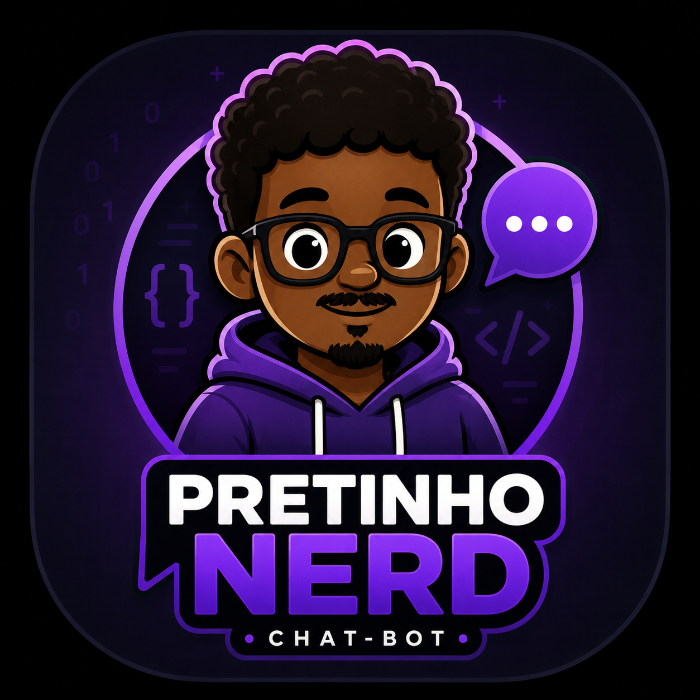

# 🤖 Pretinho Nerd - AI Study Assistant

## 📚 Sobre o Projeto

O **Pretinho Nerd** é um chatbot inteligente desenvolvido em Python com o objetivo de auxiliar estudantes durante seus estudos, principalmente na preparação para o **ENEM 2026**.

O aplicativo funciona como um assistente virtual de estudos, permitindo que o usuário converse com uma inteligência artificial, tire dúvidas, revise conteúdos e organize seu aprendizado.

O projeto foi desenvolvido como uma aplicação desktop utilizando interface gráfica moderna, armazenamento de conversas e integração com agente de inteligência artificial.

---

# 🚀 Funcionalidades

## 💬 Chat com Inteligência Artificial

- Conversas com IA em tempo real
- Respostas personalizadas para estudos
- Explicações passo a passo
- Auxílio em exercícios e conteúdos escolares

## 🗂️ Gerenciamento de Conversas

- Criar novas conversas
- Salvar histórico automaticamente
- Abrir conversas antigas
- Excluir conversas
- Geração automática de títulos

## 🎨 Interface Gráfica

- Interface moderna utilizando CustomTkinter
- Tema escuro
- Balões de mensagens estilo aplicativos de conversa
- Sidebar responsiva
- Ícone personalizado do aplicativo

## ⚡ Performance

- Processamento de respostas em segundo plano utilizando Threads
- Interface continua responsiva durante a comunicação com a IA

---

# 🛠️ Tecnologias Utilizadas

## Linguagem

🐍 Python

## Interface

- CustomTkinter
- Tkinter

## Imagens

- Pillow (PIL)

## Banco de Dados

- SQLite

## Inteligência Artificial

- Agente de IA personalizado

---

# 📂 Estrutura do Projeto

